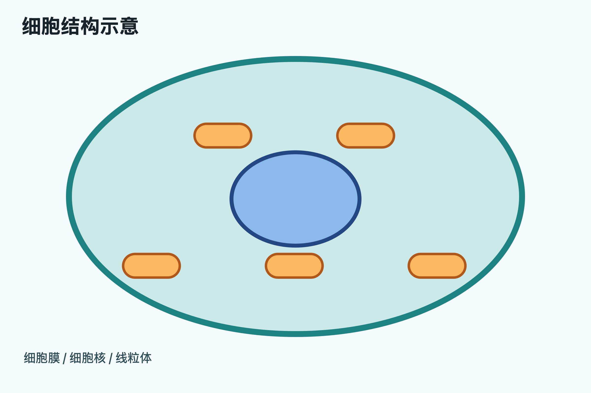

# 细胞里的城市

细胞不是一袋随机漂浮的液体，而是一座有边界、有交通、有能量系统的城市。中文科普书的排版需要让正文、图片、图注和知识卡片互相解释，而不是把图片当成正文后面的附件。

## 能量从哪里来

线粒体负责把营养物质中的化学能转换成细胞可以使用的能量。这个过程很难只靠文字讲清楚，因此版面需要给示意图足够空间，并让图注紧贴图片。

> 科普页面的目标不是装饰文字，而是降低理解成本。

> [!NOTE] ATP
> ATP 可以理解成细胞内部短距离流通的能量凭证，哪里需要做功，哪里就会快速消耗它。

- 细胞膜负责边界管理。
- 线粒体负责能量转换。
- 细胞骨架负责内部支撑和运输。

| 结构 | 类比 | 主要作用 |
| --- | --- | --- |
| 细胞膜 | 城墙和门禁 | 控制物质进出 |
| 线粒体 | 发电站 | 提供能量 |
| 细胞骨架 | 道路和支架 | 支撑与运输 |

## 为什么图注很重要

图注不是图片的名字，而是读者理解图片的入口。layoutD 会把 Markdown 图片自动转换成结构化 figure 段落，让排版引擎可以稳定处理图文关系。
