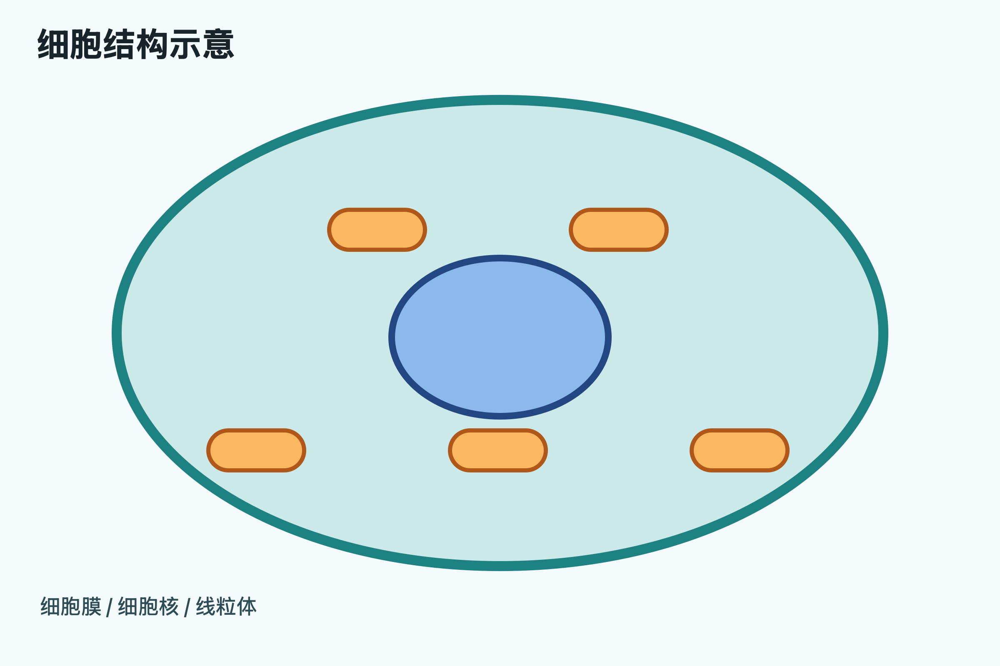

一级标题/章名
深海不是黑暗的尽头

开节概述
阳光只能照进海面以下大约两百米。再往下，是一片被称作"午夜带"的水域——没有光合作用，没有昼夜，水温接近冰点。人们曾经以为那里是荒芜的坟场，直到探照灯第一次照进去。

越往深处，生命反而越擅长制造自己的光。这一章要讲的，就是黑暗如何逼出了地球上最精巧的一批发明。

二级标题/节名
光为什么会消失

海水像一层层叠起来的滤镜。红光最先被吸收，几米之内就消失；蓝光穿透力最强，却也在两百米处所剩无几。于是深海生物眼里的世界，早已不是我们熟悉的七彩，而是一片渐次熄灭的蓝。

正是在这样的环境里，"自己发光"从奢侈变成了刚需。捕食、求偶、逃命，都要靠光来完成。

抽言
在没有光的地方，光成了最贵的语言。

三级标题/文章名
一盏灯的三种用法

生物发光并不是单一的把戏。同一束冷光，在不同物种手里能玩出完全不同的花样。

- 诱捕：鮟鱇把发光器官吊在头顶，像渔夫甩出一枚会亮的鱼饵。
- 警告：某些桡足类受惊时喷出发光液体，在捕食者身上留下"记号"，引来更大的天敌。
- 隐身：一些鱼用腹部的光抵消来自上方的微光，让自己在剪影里消失。

> 会发光的生物不是在照亮黑暗，而是在利用黑暗——它们精确地决定，谁能看见这束光。

深海的发光大多是化学反应的产物：荧光素在荧光素酶的催化下与氧结合，把化学能几乎无损耗地变成光，热量极少。这种"冷光"效率之高，至今仍是人造光源难以企及的。

| 用途 | 代表生物 | 光的作用 |
| --- | --- | --- |
| 诱捕 | 鮟鱇 | 把猎物骗到嘴边 |
| 警告 | 桡足类 | 引来更大的天敌 |
| 隐身 | 灯笼鱼 | 抵消上方微光 |

参考文献
[1] 大洋深处生物发光研究综述. 海洋科学, 2021.
[2] Widder, E. A. Bioluminescence in the Ocean. Science, 2010.
